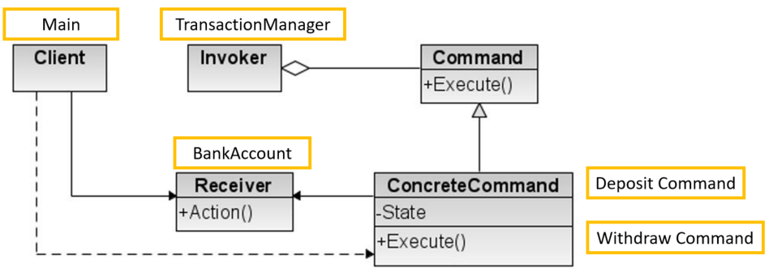

# A4.4 — Padrão Command

**Tópicos Avançados de POO · 2026/27**

O projeto aplica o padrão **Command** à gestão de depósitos e levantamentos numa conta bancária. O `TransactionManager` mantém o histórico das transações e permite desfazer a última operação. O exemplo base está implementado; a funcionalidade de transferência entre contas será desenvolvida integralmente pelos estudantes.

## Modelo inicial

## Atividade preparatória — Explorar o exemplo

Execute o `Main` e observe os saldos e o histórico apresentados antes e depois do undo. Analise as classes fornecidas e o diagrama UML e responda às seguintes questões:

1. Quais são os participantes do padrão Command nas classes fornecidas? Indique a classe ou interface correspondente a cada participante e a sua responsabilidade.
2. Como consegue o gestor executar operações sem conhecer os comandos concretos?
3. Por que motivo o histórico permite desfazer as transações pela ordem inversa à sua execução? Relacione a explicação com o comportamento observado no `Main`.

## Atividade 1 — Histórico com data de execução

**Problema:** o histórico identifica apenas o tipo de comando, sem indicar quando a transação ocorreu nem o montante envolvido.

**Requisitos:**

- Cada transação concluída com sucesso deve ter associada a data e hora da sua execução.
- O histórico deve apresentar o tipo de operação, o montante e a data de execução.
- Uma operação falhada não deve ser registada como uma transação realizada.
- Desfazer uma operação deve retirá-la do histórico, preservando os dados das restantes transações.
- A informação comum aos diferentes comandos deve ser representada sem duplicações desnecessárias.

**Sugestão de desenho:** considere transformar a interface `Command` numa **classe abstrata**, incluindo um atributo `date` do tipo `java.util.Date`, comum aos diferentes comandos.

**Atenção:** a data deve ser atualizada em cada execução bem-sucedida do comando, no método `execute()`. Não deve ser definida apenas no construtor, pois a criação e a execução do comando podem ocorrer em momentos diferentes. Uma execução falhada não deve registar uma nova data de execução; o undo deve preservar a data da execução original.

O comportamento dos depósitos, levantamentos e undo deve manter-se correto.

## Atividade 2 — Transferência entre contas

**Problema:** pretende-se transferir dinheiro entre duas contas e desfazer a transferência através de uma única operação de undo.

**Requisitos:**

- Criar de raiz a classe `TransferCommand` para representar uma transferência entre uma conta de origem e uma conta de destino. **Esta classe não é fornecida:** cabe ao estudante definir os seus atributos, construtor e métodos, respeitando a abstração dos comandos.
- Uma transferência bem-sucedida deve reduzir o saldo da origem e aumentar o saldo do destino pelo mesmo montante.
- A transferência deve constituir **uma única transação** no histórico, identificando as duas contas, o montante e a data de execução.
- Desfazer a transferência deve inverter o seu efeito nas duas contas.
- Se a execução ou o undo falhar, os saldos e o histórico devem permanecer como estavam antes dessa tentativa. Não podem existir alterações parciais.

| Situação inválida | Resultado esperado |
| --- | --- |
| Conta nula, contas iguais ou montante não finito ou não positivo | `IllegalArgumentException`, sem alterações. |
| Saldo insuficiente na origem | `IllegalStateException`, sem alterações. |
| Saldo insuficiente no destino para desfazer a transferência | `IllegalStateException`, mantendo a transação no histórico. |

**Restrição de desenho:** a nova funcionalidade deve integrar-se sem alterar `BankAccount` nem a lógica de execução e undo de `TransactionManager`. O gestor deve continuar a tratar todos os comandos de forma uniforme.

## Verificação e entrega

Acrescente ao `Main` um cenário independente com duas contas e confirme os resultados seguintes:

| Momento | Saldo da origem | Saldo do destino | Transações no histórico |
| --- | ---: | ---: | ---: |
| Inicial | 1000.0 | 300.0 | 0 |
| Após transferir 200.0 | 800.0 | 500.0 | 1 |
| Após undo | 1000.0 | 300.0 | 0 |

- Demonstre também uma transferência inválida e confirme a ausência de alterações nas contas e no histórico.
- Confirme que os depósitos, levantamentos e respetivo undo mantêm o comportamento do exemplo base. Não são fornecidos testes automáticos; a demonstração dos requisitos deve constar dos cenários do `Main`.
- Verifique a presença da data e a descrição das transações. A apresentação deve estar em inglês, com uma transação por linha.
- Atualize o diagrama de classes para refletir a solução desenvolvida.

Considere operações sequenciais através do mesmo gestor e um objeto comando por transação.

**Reflexão:** que alterações foram necessárias no invocador para suportar o novo comando? O que aconteceria ao undo se a transferência fosse registada como duas transações independentes?
